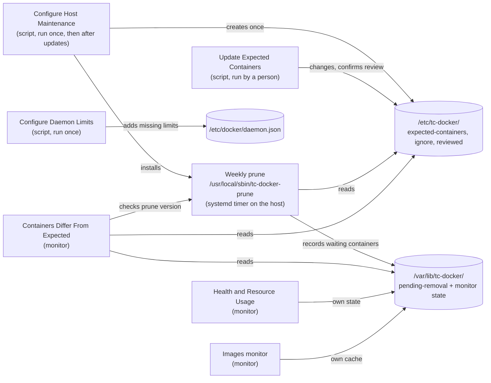

# Docker on Linux hosts: the components and how they fit

This guide is for a technician setting up or looking after a Linux host that
runs Docker. It explains what each of our six Docker components does, how they
depend on each other, the order to set them up in, and what you should expect
to see once they are running.

It is an overview. **Each component's own README is the reference** for its
input variables, exit codes and edge cases, and it wins wherever this guide is
less exact. Links to all six are in the next section.

## The six components

| Component | Kind | What it is for |
|---|---|---|
| [Docker - Configure Host Maintenance [Lin]](../Scripts/docker-configure-host-maintenance-lin/) | Script | Creates the host's **expected-containers list** (once) and installs a **weekly prune** that cleans up what nothing uses |
| [Docker - Update Expected Containers [Lin]](../Scripts/docker-update-expected-containers-lin/) | Script | The one way to **look at or change** the expected list, the ignore patterns, and whether a person has **reviewed** the list |
| [Docker - Configure Daemon Limits [Lin]](../Scripts/docker-configure-daemon-limits-lin/) | Script | Adds **log rotation and build-cache limits** to Docker's `daemon.json` |
| [Docker - Containers Differ From Expected [Lin]](../Monitors/docker-containers-differ-from-expected-lin/) | Monitor | Alerts when an **expected container is stopped or gone**, a stopped container is **about to be pruned**, the list has **gone unreviewed**, or the host's prune is **out of date** |
| [Docker - Container Health and Resource Usage [Lin]](../Monitors/docker-container-health-and-resource-usage-lin/) | Monitor | Alerts on **unhealthy, restart-looping, out-of-memory, crashed or resource-hungry** containers |
| [Docker Images monitor [Lin]](../Monitors/docker-images-monitor-lin/) | Monitor | Alerts when a running container's **image is behind** what its tag now points to in the registry |

The last three are monitors and the first three are scripts you run as jobs.

All six are safe to target at every Linux device: on a host without Docker
they exit 0 and change nothing.

## How they fit together

The core idea is a per-host **expected-containers list**: the containers this
host is supposed to run. Host Maintenance creates it, a person reviews it
using Update Expected Containers, the weekly prune protects what is on it, and
the Containers Differ From Expected monitor compares the host against it.

Daemon Limits, the Health monitor and the Images monitor are independent: each
is useful on its own and none reads the expected list. Host Maintenance,
Update Expected Containers and the Containers Differ From Expected monitor are
one system and are meant to be deployed together.

### What lives on the host

| Path | Written by | What it is |
|---|---|---|
| `/etc/tc-docker/expected-containers` | Host Maintenance (once), then Update Expected Containers | One key per line: `compose:<project>/<service>` or `name:<container>` |
| `/etc/tc-docker/ignore` | Same | Regular expressions for containers that come and go (CI jobs, for example) and should never count as unexpected |
| `/etc/tc-docker/reviewed` | Update Expected Containers (Confirm reviewed) | Proof that a person checked the list. **Until it exists the prune removes no container and no image** |
| `/usr/local/sbin/tc-docker-prune` | Host Maintenance | The prune script. Its first line of output is its version |
| `/etc/default/tc-docker-prune` | Host Maintenance | The prune's settings (age and grace period). Read as text, never executed |
| `/etc/systemd/system/tc-docker-prune.service` and `.timer` | Host Maintenance | Runs the prune on schedule, only while Docker is already running |
| `/var/lib/tc-docker/pending-removal` | The prune | Stopped containers the prune has recorded and will remove after the grace period |
| `/var/lib/tc-docker/` (other files) | The three monitors | Each monitor's own state: first-seen times, restart baselines, registry cache |
| `/etc/docker/daemon.json` | Daemon Limits | Docker's own settings; only missing keys are added, with a backup |

Everything under `/var/lib/tc-docker` is root-only. The Health and Images
monitors used `/var/lib/tc-docker-monitor` before; they read their old file
once and leave the old folder alone, so you can delete it by hand later.

## Rules every component follows

- **Nothing ever starts a stopped Docker.** If someone stopped Docker on
  purpose, the scripts, the prune and the monitors leave it stopped. They ask
  systemd first and run no docker command while `docker.service` is stopped.
- **Nothing restarts Docker.** A `daemon.json` change waits for the next
  restart or reboot, and the output says `RESTART PENDING`.
- **Nothing is deleted on a host until a person reviews its list.** Before
  review, the prune only clears unused networks and build cache.
- **A stopped container is never removed without warning.** After review the
  prune first records it as waiting, the monitor reports it with the date it
  will go, and the prune removes it only on a later run, at least the grace
  period after recording it.
- **Never removed:** volumes, tagged images, containers on the list,
  containers with restart policy `always` or `unless-stopped`, and anything
  labelled `tc.keep`.
- **"Docker did not answer" is never read as "no containers."** If Docker does
  not return its container list, the prune removes nothing and the monitors
  alert.
- **Monitors always say something.** Every run prints exactly one result
  block, and an unexpected failure still produces an alert with text in it.

## Setting up a host

Follow this order the first time a Docker host is brought under management.
Test on one internal host first, then one client device, then wider.

### 1. Configure Host Maintenance, in Report mode

Run **Docker - Configure Host Maintenance [Lin]** with `usrMode` = `Report`.
It changes nothing and prints the expected list it would create. Read it: it
should be the containers that belong on this host.

### 2. Configure Host Maintenance, in Apply mode

Run it again with `usrMode` = `Apply`. It:

- creates `/etc/tc-docker/expected-containers` from **every container present
  now, running or stopped**, marked **not reviewed**;
- installs the weekly prune (default schedule Sunday 04:00 local time, plus up
  to 30 minutes' random delay per host).

Until step 4 the prune deletes no containers or images on this host.

### 3. Configure Daemon Limits (optional, recommended)

Run **Docker - Configure Daemon Limits [Lin]**, `Report` first, then `Apply`.
It adds log rotation (10 MB × 3 files per container by default) and
build-cache limits, but only where they are missing; it never changes a value
someone already set. The changes take effect at Docker's next restart or the
host's next reboot. Log rotation only applies to containers created after
that.

Suggested post-condition on the job: warn on `RESTART PENDING`, fail on
`DAEMON WILL NOT START`.

### 4. Review the list

Run **Docker - Update Expected Containers [Lin]**:

1. `usrAction` = **Show**. It lists the expected containers and compares them
   with what is on the host.
2. **Remove** anything that has been retired. A stopped container left on the
   list is kept forever.
3. **Add** anything missing, or **Add ignore** for containers that come and go
   (for example `^name:runner-` for GitLab CI jobs).
4. **Confirm reviewed**, with `usrItems` set to your name and the ticket
   number.

From now on the prune may remove stopped, unprotected containers (after the
wait) and old untagged images on this host.

### 5. Turn on the monitors

| Monitor | Suggested interval | Notes |
|---|---|---|
| Containers Differ From Expected | 15 to 60 minutes | Needs the expected list from step 2 |
| Health and Resource Usage | 15 minutes | Replaces the old `Docker Monitor [LIN]`. **Do not run both.** |
| Images monitor | 15 minutes or more | Needs the `docker-buildx-plugin` package on the host. Results are cached for 12 hours, so the interval does not change registry load much |

All three use a 120-second timeout in Datto.

## What to expect day to day

### The weekly prune

Each Sunday (by default) the prune runs on the host. Its output is in the
host's journal (`journalctl -u tc-docker-prune.service`). Expect it to:

- clear unused networks and build cache older than 7 days;
- once the list is reviewed: record stopped containers that nothing protects
  and that have been stopped for 7 days, remove ones it recorded at least 6
  days earlier and that are still stopped, and remove untagged images over 7
  days old that no container uses;
- keep everything else, and list what it kept and why.

With the defaults, a container that stops and stays stopped is removed about
two weeks later: one week to become old enough, then recorded, then removed at
the next weekly run. The monitor names it, with its removal date, the whole
time it is waiting.

If Docker is stopped when the timer fires, the prune does not run that week.
It is not made up later.

### Alerts and what to do about them

From **Docker - Containers Differ From Expected [Lin]**:

| The alert says | What it means | What to do |
|---|---|---|
| `... stopped (name:x)` or `... missing (compose:p/s)` | An expected container is not running, or no longer exists | Start or redeploy it. If it was retired on purpose, **Remove** it from the list |
| `Docker is stopped ...; its expected containers are not running` | `docker.service` is stopped on a host with expected containers | If that was on purpose, it clears when Docker starts. Otherwise `systemctl start docker` |
| `N stopped container(s) will be removed by the prune (name:x from <date>)` | The prune has recorded a stopped container and will remove it on that date | To keep it: **Add** it to the list. To let it go: do nothing |
| `list NOT REVIEWED for N days` | Nobody has confirmed this host's list | Do step 4 above. While it is unreviewed, stopped or missing containers do not alert on their own |
| `prune on this host is version N, older than M` | The host's installed prune is out of date | Run Configure Host Maintenance on the host again |
| `unlisted (name:x)` | A container has been running for over 24 hours and is not on the list (a warning by default, not an alert) | If it belongs there, **Add** it; if it churns, **Add ignore**; otherwise find out where it came from |
| `with unreadable Compose labels` | A container's Compose labels are not plain names, so it cannot be listed and is never pruned | Find out where it came from |
| `Check could not run: Docker did not answer within 40 seconds` or `... did not return its container list` | Docker is up but not answering properly | Look at `systemctl status docker` and `journalctl -u docker` on the host |

From **Docker - Container Health and Resource Usage [Lin]**: a container
reported unhealthy by its healthcheck, restarting 3 or more times between runs,
killed for running out of memory, or exiting with an error in the last hour;
or over 90% of its own CPU allowance or memory limit for 2 runs in a row. The
diagnostic lists every running container with its numbers. A container stopped
with `docker stop` is named but does not alert, by default.

From **Docker Images monitor [Lin]**: a container whose tag has moved on in
the registry and whose new image is at least 7 days old (containers on pinned
versions are reported, not alerted), or a registry that has not answered for
7 days (usually a broken `docker login` for root, or permanent rate limiting).
It never pulls an image.

### When Docker is stopped on purpose

Stopping Docker for maintenance is fine. The prune skips that week, the
Health and Images monitors report "Docker is stopped" as healthy, and the
Containers Differ From Expected monitor alerts only if the host has expected
containers (they are not running, after all). Nothing starts Docker again
behind your back.

## Changing things later

| Situation | Run |
|---|---|
| A new app is deployed and belongs on the host | Update Expected Containers, **Add** |
| A container or Compose service was retired | Update Expected Containers, **Remove** |
| A host was rebuilt and what runs now is right | Update Expected Containers, **Show**, then **Accept current** |
| A CI or test host keeps reporting short-lived containers | Update Expected Containers, **Add ignore** |
| You want a different prune schedule, age or grace period | Configure Host Maintenance with new `usrPruneSchedule`, `usrPruneOlderThanHours` or `usrPruneGraceHours` |
| You want to prune now rather than wait for Sunday | Configure Host Maintenance with `usrPruneNow` = `Yes` |
| You want to stop pruning containers on a host | Delete `/etc/tc-docker/reviewed`. The prune goes back to removing nothing but networks and build cache, and clears its waiting list |
| A component was updated in this repo | Paste the new version into Datto, then run Configure Host Maintenance on each Docker host so its prune is replaced |

The expected list can also be edited by hand over SSH; nothing overwrites it.
Update Expected Containers is preferred because Datto's job history records
who changed what.

## Rolling out a new version

1. Update the components in Datto from this repo (see each README's
   *Installing it in Datto*). Record the UID Datto assigns, by pull request.
2. **Run Configure Host Maintenance on every Docker host before updating the
   Containers Differ From Expected monitor.** The monitor flags a host whose
   prune is older than it accepts, and alerts by default. Alternatively, set
   the monitor's `usrStalePruneAction` to `Warn` for the rollout.
3. After updating the Images monitor, check one run of each existing policy:
   its input variables were renamed with a `usr` prefix in version 3, and the
   old names are only read as a fallback.

## Where to look on a host

    cat /etc/tc-docker/expected-containers
    cat /etc/tc-docker/reviewed                # absent: not reviewed yet
    cat /var/lib/tc-docker/pending-removal     # containers waiting to be removed
    systemctl list-timers tc-docker-prune.timer
    journalctl -u tc-docker-prune.service      # what each prune removed and kept
    sudo /usr/local/sbin/tc-docker-prune       # run the prune by hand

## For people changing the code

The components share code: blocks marked `# >>> tc-docker ...` must be
byte-identical in every copy, and CI's "Shared blocks match" check fails a pull
request when they are not. Change every copy together. Each component has a
`test.json` that CI runs on a real Docker host for every pull request; see
[`tools/test-harness/README.md`](../tools/test-harness/README.md) and
[`CONTRIBUTING.md`](../CONTRIBUTING.md).
